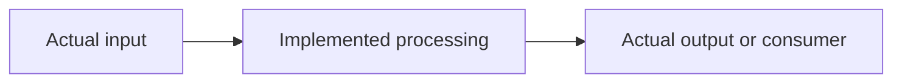

# Three-document skeleton

Split the sections below into the named output files. Replace bracketed guidance;
omit inapplicable rows rather than inventing content. Adapt headings and diagram
nodes to the actual project. Relative links resolve from each output file.

## File: README.md

# [Project] — Overview

[One sentence: problem, intended user, useful result.]

As of: [date] · Repository: [revision or none; dirty scope]

Evidence scope: [sources/revisions inspected; stale or unassessed areas].

| At a glance | Current picture | Evidence |
|---|---|---|
| Development stage | [Stage with basis, not a percentage] | [Source] |
| Implemented | [Major capabilities and verification scope] | [Source] |
| Missing / unverified | [Separate known absence from not tested/assessed] | [Source] |
| Main blockers / risks | [Most consequential issues, in plain language] | [Source] |

## How it fits together

Text flow: [Actual input] → [Implemented processing] → [Actual output/consumer].

[Short explanation of architecture and why these boundaries matter. Label any
inferred rationale. Keep proposals out of the current-flow diagram.]

## What matters next

| Order | Problem / opportunity | Immediate action | Why / dependency |
|---|---|---|---|
| [Order, not an invented audit priority] | [Plain-language issue] | [Proposed action] | [Benefit; prerequisite; evidence link] |

[Explain the important gaps, uncertainty, and decisions in short paragraphs as
needed; the reader should not need an audit to understand the basic problems.]

## Read next

- [Architecture and pipeline](pipeline.md)
- [Problems, decisions, and next steps](roadmap.md)
- [Selected technical evidence: actual source/map/audit links]

## File: pipeline.md

# Architecture & Pipeline Guide

As of: [date and revision; section-specific older evidence if retained].

## Current architecture

[One-paragraph mental model; current-flow Mermaid plus readable text fallback.
Show real branches, artifact boundaries, and manual steps where relevant.]

| Stage / purpose | Inputs → outputs | Current behavior / connection | Limitation / evidence |
|---|---|---|---|
| [Discovered stage] | [Input → output] | [What exists; predecessor/successor] | [Status and link] |

### [Stage needing explanation]

[Optional deeper explanation after the high-level table. Describe real errors,
constraints, replaceable parts, and experimental choices rather than listing
all source modules.]

## Target architecture — proposed, not implemented

[Explain improvements separately. If useful, include a second clearly labeled
diagram with text fallback; do not imply a target exists if none is documented
or justified.]

| Proposed change | Local reason / best practice | Alternative / trade-off | Validation needed |
|---|---|---|---|
| [Change] | [Evidence-linked problem] | [Simpler option and cost] | [Test or experiment, not invented result] |

## Stable boundaries and experimentable parts

[Which components/contracts must remain compatible; which may be replaced or
compared experimentally, and why. Relevant source links.]

## File: roadmap.md

# Problems, Decisions & Next Steps

As of: [date and revision; scope]. Recommendations are proposals, not implemented
features. [Explain relation to any original audit priorities/lifecycle.]

## Fix now

| Priority / order | Area | Problem | Recommended action | Expected benefit | Evidence |
|---|---|---|---|---|---|
| [Evidenced priority or explained order] | [Area] | [Problem] | [Action] | [Benefit] | [Specific link / finding ID] |

[For each important action: why, dependencies, immediate step, validation,
simpler alternative, and trade-off. Link detailed findings rather than copying.]

## Experiment first

| Question / hypothesis | Comparison and decision criterion | Prerequisites | Trade-off |
|---|---|---|---|
| [Unproven improvement] | [Baseline; what result would justify adoption] | [Data / correctness work] | [Cost / limitation] |

## Future considerations

[What can safely wait, why, and the trigger for reconsideration.]

## Open questions

[Unresolved requirements, missing evidence, and decisions; explain how to resolve
each and what it blocks. Use "none identified in scope" if appropriate.]

## Prior decisions and experiments

| Documented decision / experiment | Known outcome / rationale | Source and limits |
|---|---|---|
| [Known history only, or state none found] | [Do not infer author intent] | [Document/commit; uncertainty] |
